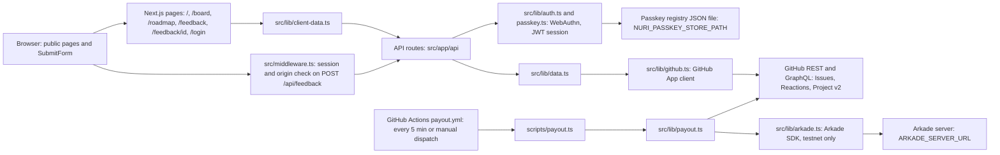
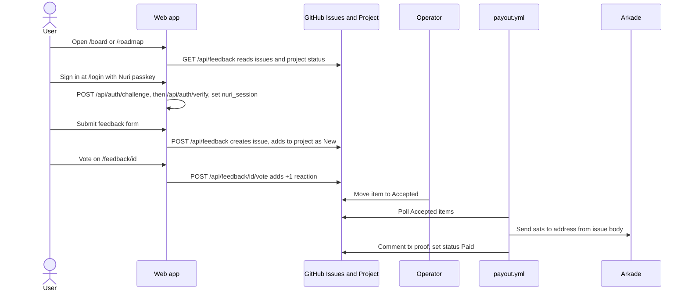

# Nuri Feedback Board

A public feedback board and roadmap for Nuri, backed by GitHub Issues and a GitHub Project.
Signed-in users submit feature requests, bug reports and improvement suggestions, and vote on them.
One human acceptance step, then accepted items can be paid in Bitcoin via Arkade (testnet-only in code today).

## Logs

- [CHANGELOG.md](CHANGELOG.md): release notes and commit history
- [PROMPTLOG.md](PROMPTLOG.md): owner instructions that shaped this repo

## Status

| Field | Value |
| --- | --- |
| Version | v0.1.0 |
| Date | 2026-10-14 |
| Updated by | hermes-agent for emino |
| Default branch HEAD | `00524d4` (main) |
| Deployment | Repo targets `feedback.nuri.com`: Vercel, or self-hosted via `scripts/deploy.sh` (PM2 on port 3456 behind nginx, `scripts/nginx-feedback.nuri.com.conf`). Live state: UNVERIFIED |
| Payouts | GitHub Actions `payout.yml`, opt-in via Actions variable `PAYOUT_ENABLED == 'true'`; mainnet refused in `src/lib/arkade.ts` |

## Tech Stack

- Next.js 15 (App Router)
- TypeScript
- Tailwind CSS
- shadcn/ui (neutral/light theme)
- Zod for input and environment validation
- GitHub Issues + GitHub Project (v2) as source of truth
- Nuri passkey authentication (WebAuthn via `@simplewebauthn/server`, JWT session via `jose`)
- Arkade TypeScript SDK (`@arkade-os/sdk`) for Bitcoin payouts

## Architecture



More detail: `docs/architecture.md`.

## User flow



Project statuses (`src/lib/types.ts`): New, Under Review, Planned, In Progress, Accepted, Paid, Dismissed.
Categories: feature, bug, improvement.

## Components

| Component | Path | Role |
| --- | --- | --- |
| Pages | `src/app/page.tsx`, `src/app/board`, `src/app/roadmap`, `src/app/feedback`, `src/app/feedback/[id]`, `src/app/login` | Landing, board, roadmap, list, detail, sign-in |
| Layout | `src/app/layout.tsx`, `src/components/SiteNavigation.tsx` | Header, nav, footer |
| UI components | `src/components/*.tsx`, `src/components/ui/*` | Cards, badges, vote button, roadmap column, submit form, auth UI |
| Middleware | `src/middleware.ts` | Requires session and trusted origin for POST `/api/feedback/*` |
| Feedback API | `src/app/api/feedback` | List, detail, create, vote |
| Auth API | `src/app/api/auth`, `src/app/api/me` | Passkey challenge and verify, logout, current user |
| Auth lib | `src/lib/auth.ts`, `src/lib/passkey.ts` | JWT sessions, WebAuthn verification, registry file |
| GitHub client | `src/lib/github.ts` | GitHub App auth, issues, comments, reactions, Project v2 GraphQL |
| Data layer | `src/lib/data.ts`, `src/lib/client-data.ts` | Server and client data access |
| Payout lib | `src/lib/payout.ts`, `src/lib/arkade.ts` | Parse payout info, send via Arkade, record proof, set Paid |
| Payout script | `scripts/payout.ts` | Entry point for `payout.yml`; `--self-test` offline check |
| Env validation | `src/lib/env.ts` | Zod schema for required env vars |
| Deploy | `scripts/deploy.sh`, `ecosystem.config.js`, `scripts/nginx-feedback.nuri.com.conf` | SSH deploy, PM2 config, nginx vhost |
| CI | `.github/workflows/ci.yml` | Install, lint, build on push and PR to main |
| Payout workflow | `.github/workflows/payout.yml` | Scheduled and manual Arkade payouts |
| Docs | `docs/architecture.md`, `docs/tasks/*`, `src/app/api/auth/README.md` | Architecture, task packets, auth contract |

## API / Endpoints

| Method | Path | Auth | Purpose |
| --- | --- | --- | --- |
| GET | `/api/feedback` | none | List feedback items with project status and votes |
| POST | `/api/feedback` | session + origin (middleware) | Create issue from JSON body, add to project as New |
| GET | `/api/feedback/[id]` | none | One feedback item by issue number |
| POST | `/api/feedback/[id]/vote` | session + origin (middleware) | Add a +1 reaction, return vote count |
| POST | `/api/auth/challenge` | origin | Start passkey sign-in, set challenge cookie |
| POST | `/api/auth/verify` | origin + challenge cookie | Verify WebAuthn assertion, set `nuri_session` |
| POST | `/api/auth/logout` | origin | Clear session and challenge cookies |
| GET | `/api/me` | session | Return `{ username }` or 401 |

Contract details: `src/app/api/auth/README.md`.

## Run

```bash
pnpm install
cp .env.example .env.local   # fill values
pnpm run dev                  # http://localhost:3000
pnpm run lint
pnpm run build
pnpm run start
```

Tests and checks:

```bash
pnpm exec tsx scripts/payout.ts --self-test              # offline payout regression check
node --test src/app/api/feedback/feedback.test.mjs       # offline feedback API contract
pnpm exec tsx --test src/app/api/auth/auth.test.ts       # run after pnpm build
node --test src/components/__tests__/public-ui.test.mjs  # against a production build on 127.0.0.1:3187
node src/components/__tests__/public-ui.browser.mjs      # optional Playwright browser check
```

Env vars read by the code (names only, values never in the repo):

| Group | Names |
| --- | --- |
| GitHub | `GITHUB_APP_ID`, `GITHUB_PRIVATE_KEY`, `GITHUB_PROJECT_ID`, `GITHUB_REPO`, `GITHUB_TOKEN` (payout workflow), `NEXT_PUBLIC_GITHUB_REPO`, `NEXT_PUBLIC_GITHUB_PROJECT_URL` |
| Auth | `AUTH_SECRET`, `NURI_PASSKEY_ORIGIN`, `NURI_PASSKEY_STORE_PATH` |
| Payout | `ARKADE_MNEMONIC`, `ARKADE_SERVER_URL`, `ISSUE_NUMBER`, `ISSUE_BODY`, `PROJECT_ITEM_ID`, `GITHUB_EVENT_NAME` |
| Tests | `AUTH_TEST_BROWSER_CHANNEL`, `UI_TEST_URL`, `UI_BROWSER_DEPS` |
| Workflow variable | `PAYOUT_ENABLED` (GitHub Actions variable, gates `payout.yml`) |

Real Nuri sign-in needs an operator-provisioned passkey registry file. See `src/app/api/auth/README.md`.

## Deployment

### Vercel (quickest)

1. Import `eminogrande/nuri-feedback-board` in Vercel.
2. Add the environment variables from `.env.example`.
3. Add a custom domain `feedback.nuri.com` (requires DNS CNAME).

### Self-hosted (nuri.com server)

1. Ensure Node.js >= 20, pnpm, PM2, and nginx are installed.
2. Copy `.env.example` to `/opt/nuri-feedback-board/.env.production` and fill it.
3. Run `scripts/deploy.sh` from this repo (adjust `DEPLOY_HOST` as needed).
4. Add the nginx config from `scripts/nginx-feedback.nuri.com.conf` and request an SSL cert:
   ```bash
   certbot --nginx -d feedback.nuri.com
   ```

## License

MIT, see [LICENSE](LICENSE).
